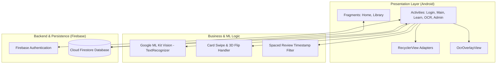

# Project Architecture & Design Overview

This document describes the design, database schema, and technical implementation details of **FlashcardApp** for the Mobile Application Development coursework.

---

## 1. High-Level Architecture

The project is structured around the standard Android Activity-Fragment lifecycle pattern, using **ViewBinding** for view safety and **Firebase Cloud Firestore** real-time listeners for dynamic UI updates:



---

## 2. Core Functional Modules

### 2.1. Authentication & Role-Based Navigation
- **Authentication**: Users sign in with Email & Password or Google Sign-In via Firebase Auth.
- **Role Routing**: After login, the app queries `users/{uid}`:
  - If `role == "admin"`, navigates to `AdminMainActivity`.
  - If `role == "user"`, navigates to `MainActivity`.
- **Live Ban Check**: `MainActivity` attaches a Firestore listener to the user document. If an admin marks status as `"banned"`, the app immediately logs the user out and redirects to `LoginActivity`.

---

### 2.2. Interactive OCR Text Extraction Pipeline

To simplify typing long flashcard definitions, the app integrates **Google ML Kit Text Recognition**:

1. User takes a photo or picks an image from the gallery in [`OcrScanActivity`](file:///app/src/main/java/com/example/flashcardapp/views/OcrScanActivity.java).
2. ML Kit extracts text blocks, lines, and bounding box coordinates on the device.
3. [`OcrOverlayView`](file:///app/src/main/java/com/example/flashcardapp/views/OcrOverlayView.java) scales and translates bounding boxes to match the `ImageView` aspect ratio:
   $$\text{scale} = \min\left(\frac{W_{\text{view}}}{W_{\text{image}}}, \frac{H_{\text{view}}}{H_{\text{image}}}\right)$$
4. When the user taps or drags across recognized words, the app highlights the boxes and automatically copies the selected text into the active Term or Definition input field.

---

### 2.3. Flashcard Learning & Gesture System

Located in [`FlashcardLearnActivity`](file:///app/src/main/java/com/example/flashcardapp/views/FlashcardLearnActivity.java):
- **Card Flip Animation**: A 3D Y-axis rotation flips between Term (front) and Definition (back).
- **Swipe Decision**:
  - **Swipe Right (Known)**: Card status set to `"mastered"` and scheduled with a review timestamp.
  - **Swipe Left (Review)**: Card status set to `"learning"` and added to the intra-session retry queue.
- **Admin Edit Sync**: When studying a system deck, the app checks if the admin updated any definitions in `global_decks`. If so, updated cards are reset so the user can re-learn them.

---

## 3. Database Schema (Firestore)

The Firestore database uses three collections:

```
Firestore
├── users/ (Collection)
│   └── {userId} (Document)
│       ├── uid: string
│       ├── name: string
│       ├── email: string
│       ├── role: "user" | "admin"
│       └── status: "active" | "banned"
│
├── global_decks/ (Collection - System templates)
│   └── {deckId} (Document)
│       ├── id: string
│       ├── title: string
│       ├── author: "Hệ thống"
│       ├── creatorId: string
│       ├── lastModified: number
│       └── cards: [ { term, definition, isLearned, status, nextReviewTime } ]
│
└── personal_decks/ (Collection - User decks & cloned copies)
    └── {deckId or userId_deckId} (Document)
        ├── id: string
        ├── userId: string
        ├── title: string
        ├── author: "bạn" | "Hệ thống"
        ├── studyCount: number
        ├── lastModified: number
        └── cards: [ ... ]
```

---

## 4. Key Design Decisions

1. **No Backend Server Needed**: Leveraging Firebase Authentication and Cloud Firestore keeps the project serverless, cost-free, and easy to run/demo for course evaluation.
2. **On-Device OCR**: Using Google ML Kit avoids needing paid external cloud OCR APIs and works offline on the device.
3. **ViewBinding**: Adopted across all activities and fragments to eliminate `findViewById` runtime null-pointer risks.
