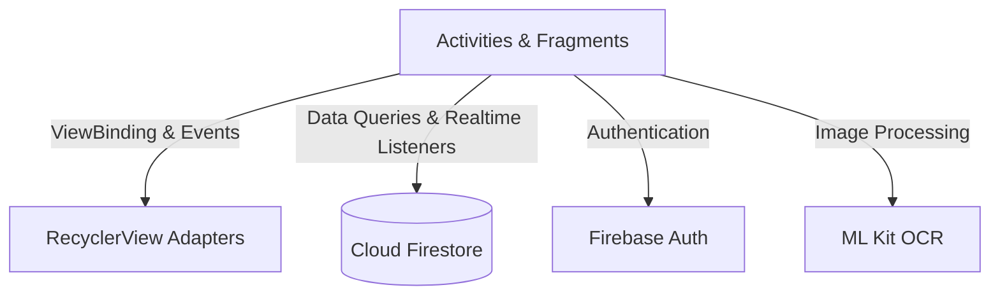

# FlashcardApp — Android Flashcard Learning Application

> **Mobile Application Development Course Project**  
> An Android application designed to help users learn vocabulary and concepts efficiently using interactive flashcards, gesture-based review, and on-device OCR scanning.

[](https://developer.android.com/)
[](https://www.oracle.com/java/)
[](https://firebase.google.com/)
[](https://developers.google.com/ml-kit)

---

## 📌 Project Overview

**FlashcardApp** is a practical student project developed for a Mobile Programming course. The application provides an intuitive mobile learning experience inspired by Quizlet and Tinder-style card swiping:
- Students can create custom flashcard sets or study from system-provided decks.
- Features quick flashcard creation by snapping photos of study notes or textbooks using Google ML Kit OCR.
- Includes a dedicated Admin module for managing system decks and monitoring basic user activity.

---

## ✨ Features

### 👤 Student / Learner Portal
- **Authentication**: Sign in and sign up via Email & Password or Google Sign-In.
- **Card Swiping Review**: Swipe right for cards you know (*Mastered*), swipe left for cards that need review (*Learning*), with a 3D flip animation to inspect definitions.
- **OCR Flashcard Scanning**: Take a picture or select an image from the gallery, tap/drag over recognized words on the screen, and automatically populate the Term and Definition fields.
- **Library & Search**: Easily toggle between your own decks and system decks, with real-time title search and suggestions.
- **Review Progress**: Visual progress bar tracking completed cards and review sessions.

### 🛡️ Admin Portal
- **Dashboard Overview**: View the top trending system decks by study count and see today's active users.
- **System Decks Management**: Create, edit, and delete default system decks with automatic cleanup of user copies.
- **User Management**: View user list, inspect a user's decks, and lock/unlock accounts in real-time.

---

## 🛠️ Technology Stack

- **Platform**: Android Native
- **Language**: Java 11 (Android SDK 29 - 36)
- **UI & Architecture**:
  - Jetpack ViewBinding
  - Custom Views (`OcrOverlayView` for interactive touch-to-select text boxes)
  - CardStackView & Touch Gestures for Tinder-style swiping
  - Material Design 3 components
- **Backend & Services**:
  - **Firebase Authentication**: Email/Password and Google OAuth2 Sign-In
  - **Cloud Firestore**: Real-time NoSQL database for decks, users, and study progress
- **On-Device Machine Learning**:
  - **Google ML Kit Text Recognition**: Local OCR processing directly on the phone without external API costs
- **Utilities**: Google Gson for JSON serialization

---

## 🏗️ Architecture & App Structure

The app uses standard Android component architecture with ViewBinding, dividing responsibilities into distinct layers:



### Key Packages
```
com.example.flashcardapp/
├── MainActivity.java               # Main navigation container (Home, Library, Create)
├── adapters/                       # RecyclerView adapters for decks, cards, and terms
├── models/                         # Data models (Deck, Flashcard)
└── views/                          # Activities for User and Admin flows
    ├── LoginActivity.java          # Authentication screen
    ├── CreateDeckActivity.java     # Deck creator & editor
    ├── FlashcardLearnActivity.java # Swipe-based flashcard review screen
    ├── OcrScanActivity.java        # Camera & OCR capture screen
    ├── OcrOverlayView.java         # Interactive text selection canvas overlay
    ├── AdminMainActivity.java      # Admin dashboard
    ├── AdminUsersActivity.java     # User account management
    └── fragments/                  # HomeFragment & LibraryFragment
```

---

## 🗄️ Database Structure (Cloud Firestore)

- **`users/{uid}`**: User profiles, roles (`user` or `admin`), and account status (`active` or `banned`).
- **`global_decks/{deckId}`**: System-wide curated decks managed by Admin.
- **`personal_decks/{id}`**: User-created decks and personalized copies of system decks with individual learning progress.

---

## 🚀 Setup & Run Instructions

### Prerequisites
- **Android Studio** (Hedgehog, Ladybug, or newer)
- **JDK 11** or **JDK 17**
- Android device or emulator running **Android 10 (API 29)** or higher with Google Play Services.

### Steps
1. **Clone the repository**:
   ```bash
   git clone https://github.com/Namstorm228/FlashcardApp.git
   cd FlashcardApp
   ```
2. **Add Firebase configuration**:
   - Place your `google-services.json` file inside the `app/` folder:
     ```
     FlashcardApp/app/google-services.json
     ```
   - In Firebase Console, ensure **Authentication** (Email/Password & Google) and **Cloud Firestore** are enabled.
3. **Open and Build**:
   - Open the project in Android Studio.
   - Let Gradle sync dependencies.
   - Run the project on an emulator or connected Android device.

---

## 👨‍💻 Course Information
- **Course**: Mobile Application Development (Lập trình ứng dụng di động)
- **Project**: Flashcard Learning App
